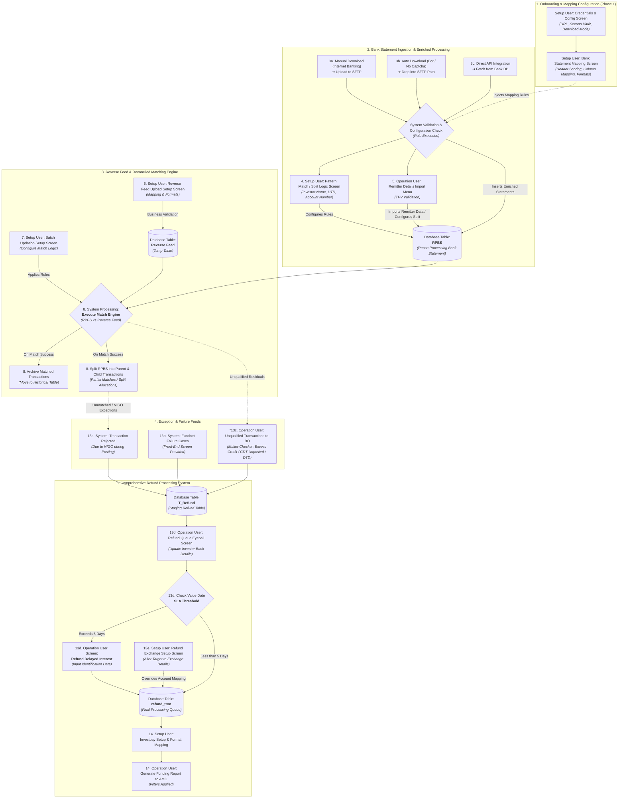
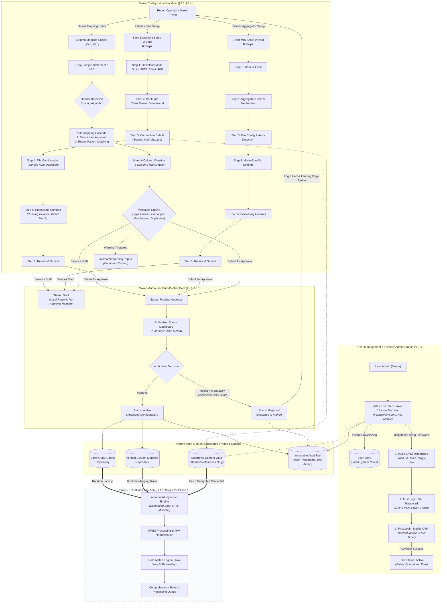

# CAMS Reconciliation System — Phase 1 PRD
## Bank Statement & Credit MIS Configuration, Mapping, and Approval

| Version | Date | Author | Status |
|---|---|---|---|
| 2.0 | 2026-09-29 | — | Superseded |
| 3.0 | 2026-10-06 | — | Superseded |
| 4.0 | 2026-10-08 | Product & Architecture Team | Baseline Review — End-to-End Recon Architecture, Phase 1 Flow, and User Management System Added |

---

# 0. Change Log

### v3 → v4 (2026-10-08)
| # | Change | Sections affected |
|---|---|---|
| 17 | **Complete Target-State Reconciliation Process Flow & Architecture Diagram added** (§2.4) immediately following Section 2. Documents the entire 6-stage end-to-end reconciliation blueprint: Onboarding & Mapping, Bank Ingestion & RPBS, Reverse Feed Matching Engine (Parent/Child Split & Archival), Exception & Failure Feeds, Fund Utilisation, and Comprehensive Refund Processing (T_Refund, 5-day Value Date SLA threshold, Delayed Interest, Exchange Overrides, Investpay, AMC Funding Reports). | §2.4 (New) |
| 18 | **Phase 1 Focused Process Flow Diagram added** (§4.2.1) immediately following Section 4.2. Features an enterprise Mermaid process flow detailing Setup Wizards, Column Mapping Engine, Standardisation, Dual-Control Maker–Authoriser loop, and clear Phase 1 / Phase 2 operational boundaries. | §4.2.1 (New) |
| 19 | **User Management & Role-Based Access Control (RBAC) Module added** (§5.7). Implements the complete system as built in the interactive prototype: four fixed roles (`Admin`, `Operator`, `Authoriser`, `Viewer`), unified `authorize(actor, action, target)` security gate, User Management Console with 4 interactive role cards (Admin: 2, Operator: 41, Authoriser: 7, Viewer: 98; total 148 seeded users), Role Permissions Drawer, Search & Filters, CSV Export, Add/Edit User Drawer with Click-to-Populate mockups, 3-screen Onboarding & First Login flow (Invite Email, Password Setup with live 6-point rules, Mobile OTP verification with timers), and complete Audit Logging. | §5.7 (New), §3.1, §6.2 |

### v2 → v3 (2026-10-06)
| # | Change | Sections affected |
|---|---|---|
| 1 | Added a **Draft** status. "Save as Draft" no longer submits for approval; a separate "Submit for Approval" action does. | §5.1.12, §5.2.16, §5.4.2, §5.4.22, §5.6, §6.7 |
| 2 | Rejected configs and mappings now appear on the **same landing page** under a **Rejected** status filter/card, with a count badge and a login alert. | §5.1.1, §5.2.1, §5.4.1, §5.6.5, §6.6 |
| 3 | **Reset** behaviour standardised: Reset restores the last saved state, and clears to defaults only if the record was never saved. | §5.1.13, §5.2.15, §6.8 |
| 4 | **Step indicator** added to the configuration wizards. | §5.1, §5.1.2, §5.4, §5.4.2, §6.10 |
| 5 | **Sample file auto-detection** pre-fills File Type, File Separator, Start Row/Column, Header Position, and Date Format. The sample uploaded during configuration is reused in mapping. | §5.1.9, §5.2.2, §5.2.3, §5.2.11, §5.4.12, §5.4.13, §5.4.16, §6.11 |
| 6 | **Re-enter Password removed** and replaced by a show/hide toggle. | §5.1.7, §5.1.9, §5.4.19, §5.4.20 |
| 7 | **Credentials moved to a secrets manager**. The config stores only a reference, and the UI shows only "Credential set". | §5.1.7, §5.1.9, §5.4.19, §5.4.20, §6.3, §6.9 |
| 8 | **Credit MIS column mapping is in scope** and reuses the bank statement mapping framework. | §4, §5.5, §8.1 |
| 9 | Bank Account Number clarified: a dropdown filtered by Bank Name, sourced from Bank Master. | §5.1.6 |
| 10 | Auto-mapping first **reuses the last approved mapping**; regex is the fallback. | §5.2.4 |
| 11 | Pagination spec condensed. The full spec moved to `Design_System_Pagination_Standard.md`. | §6.5 |
| 12 | Bank accounts with **no Credit MIS are always Direct Match only**. | §5.1.10, §8.1 |
| 13 | **One bank account can have multiple setups** with different download modes (e.g., Manual + API). The duplicate check key is Bank + Account Number + Download Mode. | §5.1.8, §8.1 |
| 14 | **One file format per bank setup.** The system supports different formats across banks, each with its own mapping. | §5.1.8, §8.1 |
| 15 | **No Bulk option in Credit MIS.** Bank Account Number is always mandatory in Credit MIS. | §5.4.8, §5.4.22, §5.5.2, §8.1 |
| 16 | Credit MIS receiver email domain is **@camsonline.com** (was @atronline.com). | §5.4.19, §8.1 |

---

# 1. Problem & Context

The Securities and Exchange Board of India (SEBI) mandates that mutual fund purchase applications shall be processed only after the corresponding funds have been realised, regardless of the transaction amount. In practice, this means that no units may be allotted to an investor until the AMC can confirm that the investor's payment has actually arrived as a credit in the mutual fund's collection bank account. This single regulatory requirement creates the need for a reconciliation system that sits at the heart of mutual fund operations.

CAMS (Computer Age Management Services) operates as the Registrar and Transfer Agent for a large number of Indian AMCs. On any given business day, CAMS processes transactions flowing in from multiple channels — direct investor applications, stock exchanges (BSE and NSE), MFU (Mutual Fund Utilities), and various payment aggregators such as Razorpay and CAMSPay. Payments for these transactions arrive into hundreds of bank accounts maintained across dozens of banks, each with its own statement format, delivery mechanism, and data structure. The reconciliation process must match these bank credits against purchase transactions to confirm fund realisation before units can be allotted.

The current reconciliation infrastructure has grown organically over many years. It handles the core matching logic, but its configuration layer — the part that tells the system how to connect to each bank, how to read each bank's statement format, and how to parse Credit MIS files from payment aggregators — is fragmented, inconsistent, and difficult to maintain. Onboarding a new bank account requires significant manual effort. Different banks deliver statements via email, SFTP, API, or portal downloads, in formats ranging from XLS and CSV to password-protected ZIPs. Each bank uses different column names, date formats, and transaction status indicators. The Credit MIS files received from payment aggregators introduce additional complexity, with their own file structures, delivery mechanisms, and matching rules.

The re-architecture of the reconciliation system aims to address five core objectives:

1. **Data accuracy and consistency** — ensuring that bank statement data is correctly ingested, columns are reliably mapped to system fields, and discrepancies are surfaced immediately rather than discovered downstream.
2. **Fraud and error prevention** — enforcing a Maker–Authoriser dual-control workflow on all configuration changes so that no single individual can create and activate a configuration that determines how millions of rupees in transactions are processed.
3. **Financial integrity** — maintaining an unbroken audit trail from configuration creation through approval to operational use, so that every processing rule applied to a bank statement or Credit MIS file can be traced back to a specific configuration, approved by a specific person, at a specific time.
4. **Regulatory compliance** — supporting SEBI's fund-realisation requirement by establishing the infrastructure that enables accurate, timely, and complete reconciliation.
5. **Risk minimisation** — reducing the manual effort and human error involved in onboarding new bank accounts, thereby lowering operational risk across the reconciliation process.

Phase 1 of the re-architecture focuses on the **configuration and mapping layer** — the foundation upon which all downstream processing (ingestion, reconciliation, fund utilisation, refunds, reporting, and GL posting) depends. Without reliable, well-governed configurations, no amount of improvement to the matching engine or reporting layer will produce accurate results.

---

# 2. Goals, Non-Goals & Success Metrics

## 2.1 Goals

Phase 1 shall deliver a centralised, governed configuration platform that enables CAMS recon operators to:

- **Configure bank statement download setups** for any bank account, specifying the delivery mode (Auto Download, Manual/SFTP, Email, or API), bank account details, file format, and processing options — all through a single, consistent interface.
- **Map bank statement columns to system fields** using a combination of intelligent auto-detection (header row scoring, regex-based column matching) and manual override, with real-time validation that prevents obvious mapping errors.
- **Configure Credit MIS setups** for payment aggregator files, covering the same range of delivery modes plus aggregator-specific fields (Payment Aggregator Code, Payment Mechanism, Account Category, Scheme Code).
- **Standardise transaction status indicators** across banks through an admin-managed mapping table that converts bank-specific values (C/D, CR/DR, SUCCESS/FAILURE, positive/negative amounts) into a single system standard (CREDIT/DEBIT).
- **Enforce dual-control governance** on all configuration changes through a Maker–Authoriser workflow, ensuring that no configuration enters operational use without independent review and approval.
- **Provide enterprise User Management & RBAC** with four fixed roles (Admin, Operator, Authoriser, Viewer), centralized authorization enforcement, instant user creation with automated invite credentials, and a secure 3-step onboarding verification flow.
- **Maintain a complete audit trail** of all configuration changes, approval decisions, user management actions, and manual overrides.

## 2.2 Non-Goals

The following are explicitly **out of scope** for Phase 1:

- **Automated file ingestion and processing engine** — Phase 1 creates the configurations that the ingestion engine will consume, but the runtime execution engine itself (scheduled bots, file monitors, parsing pipelines) is a separate implementation stream.
- **Reconciliation matching execution** — the runtime execution of two-way and three-way matching algorithms is a future phase.
- **Fund utilisation reporting generation** — the automated report that gates unit allotment is a downstream deliverable.
- **Refund processing execution** — NIGO and excess credit refund processing workflows are out of scope for Phase 1.
- **Operational Reports** — unreconciled items, cross-collection, cheque bounce, purchase register, and BRS reports are out of scope.
- **General Ledger posting** — GL integration is out of scope.
- **Physical cheque bounce instrument handling** — out of scope.
- **Custom role creation / SSO federation** — custom roles and SSO are out of scope; the four fixed roles provide complete enterprise coverage.

## 2.3 Success Metrics

| Metric | Target | Notes |
|---|---|---|
| Time to onboard a new bank account (config + mapping + approval) | **10 minutes** | Baseline from current system needed for comparison |
| Percentage of column mappings auto-detected correctly | **90%** | Driven by header scoring algorithm and regex pattern library |
| Configuration approval turnaround time | **5 minutes** | Time from Maker submission to Authoriser review action |
| User onboarding turnaround time (invite to active) | **< 3 minutes** | Self-service password creation and mobile OTP verification |
| Audit trail completeness | **100%** | Zero unlogged mutations or denied administrative attempts |

---

## 2.4 Complete Target-State Reconciliation Process Flow & Architecture

> [!IMPORTANT]
> **Complete Recon Architecture Context**: While Phase 1 focuses strictly on configuration, mapping, user administration, and Maker–Authoriser dual control, the target-state reconciliation platform encompasses six interconnected processing modules. The diagram and functional specifications below define the macro architecture governing how configurations created in Phase 1 drive downstream ingestion, matching, exception handling, and refund execution across CAMS operations.

### 2.4.1 End-to-End System Blueprint Diagram



### 2.4.2 Architectural Breakdown of the Six Core Stages

#### Stage 1: Onboarding & Mapping Configuration (Phase 1 Baseline)
- **Objective:** Provision bank connection channels, file structure parameters, and database column mappings prior to statement arrival.
- **Key Actors:** Setup User (Maker) and Team Lead (Authoriser).
- **Core Screens & Functions:**
  - `Credentials & Config Screen`: Configures communication parameters (URL, Corporate ID, SFTP upload paths, email subject filters). Credentials are offloaded to an enterprise secrets manager.
  - `Bank Statement Mapping Screen`: Parses sample statements, executes header row scoring, identifies delimiters, maps physical columns to system fields, and standardises transaction status (Credit/Debit).
- **Output:** Approved configuration records and verified column mapping templates stored in the database repository.

#### Stage 2: Bank Statement Ingestion & Enriched Processing
- **Objective:** Ingest files across multi-channel streams and enrich statement entries with Third-Party Verification (TPV) and remitter attributes.
- **Inbound Channels:**
  - `3a. Manual Download (Internet Banking)`: Operations personnel download statements from banking portals and upload to a secured SFTP path.
  - `3b. Auto Download (Bot / No Captcha)`: Scheduled daemon processes pull statements directly from bank servers into SFTP drop paths.
  - `3c. Direct API Integration`: System polls or receives webhooks directly from bank core banking systems (CBS).
- **Processing Engine:**
  - `System Validation & Configuration Check`: Validates incoming file integrity, verifies digital signatures/passwords, checks mandatory headers, and executes row-level syntactical validation.
  - `4. Pattern Match / Split Logic`: Regex and pattern engine that parses composite narration strings (extracting investor name, UTR number, virtual account number).
  - `5. Remitter Details Import Menu`: Operation users upload remitter bank files for TPV validation, matching investor PAN/bank account with application master data.
- **Target Database Entity:** `RPBS` (Recon Processing Bank Statement Table) — the unified, enriched transaction store representing all bank credits.

#### Stage 3: Reverse Feed & Reconciled Matching Engine
- **Objective:** Match confirmed bank credits in `RPBS` against mutual fund purchase application transactions (Reverse Feed) received from RTA/AMC front-office systems.
- **Core Operations:**
  - `6. Reverse Feed Upload Setup Screen`: Setup users configure format specifications and business validation rules for incoming reverse feed files, staging them into `Database Table: Reverse Feed (temp table)`.
  - `7. Batch Updation Setup Screen`: Configures matching priority cascade (UTR exact match, instrument number + amount match, fuzzy narration match with tolerance windows).
  - `8. Execute Match Engine`: Automated matching engine comparing `RPBS` vs `Reverse Feed`.
- **Match Outcomes:**
  - *Success Archival:* Matched transactions from the Reverse Feed table are archived to historical reconciliation tables.
  - *Parent & Child Split:* Partial matches or bundle payments are split within `RPBS` into Parent records (original credit) and Child records (apportioned scheme allocations).

#### Stage 4: Upstream Failure Feeds & Exception Routing
- **Objective:** Capture unallocated, rejected, or invalid transactions from upstream matching and posting engines into structured exception queues.
- **Exception Streams:**
  - `13a. System: Transaction Rejected`: Rejections resulting from NIGO (Not In Good Order) status during mutual fund allotment posting.
  - `13b. System: Fundnet Failure Cases`: Payment gateway and transaction network exceptions surfaced via front-end operational screens.
  - `13c. Operation User: Unqualified Transactions`: Back-office maker-checker review capturing Excess Credit, CDT Unposted, and Day-to-Day (DTD) unallocated credits.

#### Stage 5: Fund Utilisation & Allotment Gate
- **Objective:** Enforce SEBI fund-realisation compliance by gating mutual fund unit allotment until reconciliation confirms credit realization.
- **Operational Gate:** Post-matching, the system generates the Fund Utilisation Report. Only transactions marked as Reconciled & Realised are cleared for unit creation by the transaction processing department.

#### Stage 6: Comprehensive Refund Processing System
- **Objective:** Process, validate, calculate penal interest, and execute monetary refunds for NIGO rejections, duplicate payments, and excess credits.
- **Staging & Review:**
  - `Database Table: T_Refund`: Central holding table consolidating all exception feeds requiring refund.
  - `13d. Refund Queue Eyeball Screen`: Operations users review investor bank account details, IFSC codes, and beneficiary names.
- **SLA Threshold & Interest Logic:**
  - `13d. Check Value Date SLA Threshold`: Automated rule evaluating transaction age against regulatory turnaround thresholds (5 business days).
  - *Pathway A (> 5 Days):* Transactions trigger `13d. Refund Delayed Interest Screen`, prompting operator input of Identification Date to compute SEBI-mandated delayed interest payout.
  - *Pathway B (<= 5 Days):* Standard refund without penal interest routed directly to `Table: refund_trxn (Final Processing Queue)`.
  - `13e. Refund Exchange Setup Screen`: Overrides standard bank account mapping to redirect refund credit directly to Stock Exchange Clearing Corporation accounts (BSE/NSE) where transactions originated via exchange channels.
- **Disbursement & Reporting:**
  - `14. Investpay Setup & Format Mapping`: Integration setup configuring banking disbursement formats (NEFT/RTGS/NACH batches).
  - `14. Operation User: Generate Funding Report to AMC`: Generates filtered debit and funding requests submitted to asset management companies for refund account funding.

---

# 3. Personas & Their Jobs

## 3.1 Persona Summary

| # | Persona | Organisation | Role in Reconciliation | Phase 1 Interaction |
|---|---|---|---|---|
| 1 | **CAMS Back-Office User (Operator / Maker)** | CAMS | Primary operator. Configures bank statement and Credit MIS setups, uploads sample files, performs column mapping, reprocesses files, and submits records for approval. | **Maker / Operator**: Full access to configuration wizards, sample uploads, and mapping editors. Submits requests for dual-control review. |
| 2 | **Team Lead / Authoriser** | CAMS | Reviews and approves configuration changes, mapping templates, manual matches, refunds, and master-data changes. | **Authoriser**: Dedicated Authorisation Queue dashboard. Approves or rejects submissions with mandatory comments. Cannot edit configurations or approve own submissions. |
| 3 | **System Administrator (Lead Admin)** | CAMS | Manages user accounts, assigns fixed roles, drafts master-data changes, and maintains standardisation tables. | **Admin**: Access restricted to the User Management console and Transaction Status Standardisation table. All operational recon screens are read-only. Cannot operate recon, approve submissions, change own role, or deactivate own account. |
| 4 | **Compliance Auditor (Viewer)** | CAMS / AMC / Audit | Performs operational and regulatory audit oversight. | **Viewer**: Read-only access to configurations, mappings, audit trails, and reports. Export rights enabled. Cannot create, edit, or approve. |
| 5 | Stock Exchange (BSE & NSE) | External | Source of exchange-originated purchase transactions. | Downstream recipient of exchange refund overrides (§2.4, Stage 6). |
| 6 | Payment Aggregators (Razorpay, CAMSPay, etc.) | External | Source of Credit MIS files bridge-linking payment credits to applications. | Configurations created in Module 3 (§5.4) govern their file ingestion. |
| 7 | Banking Partners (HDFC, ICICI, SBI, Axis, etc.) | External | Source of bank statements across diverse delivery channels. | Configurations created in Module 1 (§5.1) define connection protocols. |

---

# 4. End-to-End Journey

## 4.1 A Day in the Life of a Recon Operator
*(Narrative detailing Priya's daily schedule from 9:30 AM statement arrivals through ingestion, bank onboarding, credit MIS parsing, reconciliation matching, fund utilisation sign-off, refund exception triage, and 4:00 PM GL posting).*

## 4.2 Where Phase 1 Fits

Phase 1 covers the foundational governance layer — **Bank Statement Configuration, Credit MIS Configuration, Column Mapping Engines, Transaction Status Standardisation, User Management, and Maker–Authoriser Governance**.

---

### 4.2.1 Phase 1 Detailed Process Flow & Governance Lifecycle

The following diagram defines the runtime lifecycle, user interactions, automated validation engines, and approval loops operating strictly within the Phase 1 implementation scope:



---

# 5. Capabilities

*(Sections 5.1 through 5.6 retained in full: Bank Statement Configuration, Bank Statement Column Mapping, Transaction Status Standardisation, Credit MIS Configuration, Credit MIS Column Mapping, and Authorisation Workflow).*

---

## 5.7 User Management & Role-Based Access Control (RBAC) Module

### 5.7.1 Architectural Foundation: Fixed System Roles & Single Authorization Gate

User administration in CAMS Reconciliation is governed by strict enterprise principles designed to prevent privilege escalation, enforce separation of duties, and maintain complete auditability:

1. **Fixed System Roles:** The system defines exactly four non-editable, hardcoded system roles: `Admin`, `Operator`, `Authoriser`, and `Viewer`. There is no role-creation interface, no custom role builder, and no granular permission overrides per user.
2. **Single Role Per User:** Each user holds exactly one role at any given time. Assigning a new role completely replaces the previous role assignment.
3. **Backend Authorization Enforcement (`authorize` gate):** Hiding or disabling buttons on the user interface is treated as a presentation-layer affordance, not security enforcement. Every application mutation must pass through a single, centralized authorization function:
   $$\text{authorize}(\text{actor}, \text{action}, \text{target}) \longrightarrow \{\text{ok}: \text{boolean}, \text{reason}: \text{string}\}$$
   The function evaluates the actor's active role, account status, self-operation constraints, and contextual business rules before permitting execution. Every denied attempt is immutably logged to the audit repository.
4. **Immediate Administrative Provisioning:** Unlike transactional configurations that require Maker–Authoriser dual control, user provisioning by authorized Admins takes effect immediately without secondary approval.
5. **Self-Action Prevention:** An Administrator cannot change their own role, deactivate their own account, or edit their own administrative privileges.

---

### 5.7.2 The Four Fixed System Roles (`ROLE_PERMS`)

```
+---------------------------------------------------------------------------------------------------+
|                                  CAMS FIXED ROLES TAXONOMY                                        |
+----------------------+--------------------+--------------------------------+----------------------+
|        ADMIN         |      OPERATOR      |           AUTHORISER           |        VIEWER        |
|  (User & Masterdata) | (Recon Operations) |      (Dual-Control Review)     | (Audit & Inspection) |
+----------------------+--------------------+--------------------------------+----------------------+
| CAN:                 | CAN:               | CAN:                           | CAN:                 |
| - Add/Edit/Deactivate| - Draft/edit config| - Approve/reject configs       | - View recon data    |
|   users              | - Column mapping   | - Approve master-data changes  | - View reports       |
| - Assign roles       | - Reprocess files  | - Approve manual matches       | - Export reports     |
| - Draft master-data  | - Run recon        | - Approve refunds & GL batches |                      |
| - View all (read-only| - Resolve exception| - View all recon data & reports|                      |
|                      | - Propose matches  |                                |                      |
| CANNOT:              | - Prepare GL/refund| CANNOT:                        | CANNOT:              |
| - Operate recon      |                    | - Create or edit configs       | - Change anything    |
| - Approve anything   | CANNOT:            | - Approve own submissions      | - Approve anything   |
| - Change own role    | - Approve anything | - Manage users                 | - Manage users       |
| - Deactivate self    | - Manage users     |                                |                      |
+----------------------+--------------------+--------------------------------+----------------------+
```

#### Detailed Role Permission Specifications

#### 1. Admin Role
- **CAN:**
  - Create new users, modify user profiles, and deactivate/reactivate accounts.
  - Assign any of the four fixed system roles to users.
  - Draft master-data changes (Bank Master, Scheme Master, Payment Aggregator Master, Transaction Status Standardisation).
  - View all operational recon screens, configurations, and reports in read-only mode.
- **CANNOT:**
  - Execute operational reconciliation processes or upload daily statement files.
  - Approve configuration changes, mappings, manual matches, refunds, or GL batches.
  - Modify their own role assignment (locked with tooltip: *"Admins cannot change their own role"*).
  - Deactivate their own account (locked with tooltip: *"Admins cannot deactivate themselves"*).

#### 2. Operator Role (Maker)
- **CAN:**
  - Create, edit, copy, and save draft configurations for Bank Statements and Credit MIS.
  - Upload sample files, configure header scoring, and map statement columns.
  - Reprocess failed statement files and execute reconciliation jobs.
  - Review exception queues, propose manual matches, and initiate refund requests.
  - Prepare General Ledger batches and export daily operational reports.
- **CANNOT:**
  - Approve any configuration, mapping, refund, or batch.
  - Access user administration functions.

#### 3. Authoriser Role
- **CAN:**
  - Review, approve, or reject bank statement setups, Credit MIS setups, and column mappings.
  - Approve or reject proposed manual matches, exception resolutions, refunds, and GL batches.
  - View all operational recon data, historical queues, and analytical reports.
- **CANNOT:**
  - Create, edit, or initiate configuration setups or column mappings.
  - Approve any record they created or previously modified (dual-control self-approval prohibition).
  - Manage users or assign system roles.

#### 4. Viewer Role
- **CAN:**
  - View all operational reconciliation dashboards, configurations, mappings, and audit histories in read-only mode.
  - Export data grids and generated reports to CSV/Excel format.
- **CANNOT:**
  - Create, modify, delete, or submit any record.
  - Execute approvals or manage user accounts.

---

### 5.7.3 User Management Console Specification

The User Management screen is the exclusive view accessible to users operating in the **Admin** persona.

```
+---------------------------------------------------------------------------------------------------+
|  Administration > User Management                                              [ + Add user ]     |
|  Manage users, role assignments, and account access across reconciliation operations.             |
+---------------------------------------------------------------------------------------------------+
|  ROLE DISTRIBUTION                                                                                |
|  +--------------------+ +--------------------+ +--------------------+ +--------------------+     |
|  | Admin            2 | | Operator         41| | Authoriser        7| | Viewer           98|     |
|  | Manages users & ...| | Runs day-to-day ...| | Approves or reje...| | Read-only access...|     |
|  | [View permissions] | | [View permissions] | | [View permissions] | | [View permissions] |     |
|  +--------------------+ +--------------------+ +--------------------+ +--------------------+     |
+---------------------------------------------------------------------------------------------------+
|  [ Search by name, emp no, email... ]  [ All Roles v ]  [ All Statuses v ]     [ Export CSV ]    |
+---------------------------------------------------------------------------------------------------+
| Name          | Emp No   | Designation       | Work Email             | Role       | Status   |...|
|---------------+----------+-------------------+------------------------+------------+----------+---|
| Meera Iyer    | EMP-1001 | Lead Systems Admin| meera.iyer@camson...   | Admin      | Active   |...|
| Rohit Menon   | EMP-1002 | Senior IT Admin   | rohit.menon@camson...  | Admin      | Active   |...|
| Priya Sharma  | EMP-2041 | Senior Recon Exec | priya.sharma@camson... | Operator   | Active   |...|
| Arun Mehta    | EMP-3007 | Recon Ops Manager | arun.mehta@camson...   | Authoriser | Active   |...|
| Sanjay Rao    | EMP-4098 | EDMU Auditor      | sanjay.rao@camson...   | Viewer     | Active   |...|
| Kiran Das     | EMP-2042 | Recon Analyst     | kiran.das@camson...    | Operator   | Invited  |...|
| Neha Kapoor   | EMP-4099 | Financial Analyst | neha.kapoor@camson...  | Viewer     | Expired  |...|
+---------------------------------------------------------------------------------------------------+
| Showing 1–15 of 148 Records                                        [15/page v]  < [1] 2 3 4 > Go  |
+---------------------------------------------------------------------------------------------------+
```

#### Screen Elements & Functional Specifications

#### 1. Header & Actions
- **Title:** `User Management`
- **Subtitle:** `Manage users, role assignments, and account access across reconciliation operations.`
- **Primary Action:** `+ Add user` button (opens Add User Drawer).

#### 2. Role Summary Strip (Interactive Metric Cards)
Four interactive cards displaying live system role metrics matching a realistic enterprise distribution:
- **Admin Card:** Name: `Admin`, Count: `2`, Summary: `Manages users and drafts master-data changes. Cannot operate recon or approve.`, Action: `View permissions` link.
- **Operator Card:** Name: `Operator`, Count: `41`, Summary: `Runs day-to-day recon: drafts configs, resolves exceptions, prepares refunds and GL.`, Action: `View permissions` link.
- **Authoriser Card:** Name: `Authoriser`, Count: `7`, Summary: `Approves or rejects what others create. Cannot create or edit.`, Action: `View permissions` link.
- **Viewer Card:** Name: `Viewer`, Count: `98`, Summary: `Read-only access to recon data and reports, with export.`, Action: `View permissions` link.
- **Card Interaction:** Clicking any card or its "View permissions" link opens the **Role Permissions Drawer**.

#### 3. Role Permissions Drawer (Slide-Out)
- Displays full CAN and CANNOT bullets for the selected role.
- Includes mandatory system notice: *"Roles are fixed by the system and cannot be edited. Each user has exactly one role."*
- Features primary footer action: `Show these users` (automatically filters the data grid by the selected role and closes drawer).

#### 4. Toolbar Controls
- **Global Search Input:** Live filtering across Name, Employee Number, and Work Email. Debounced 250ms with text highlighting.
- **Role Filter Dropdown:** Options: `All Roles`, `Admin`, `Operator`, `Authoriser`, `Viewer`.
- **Status Filter Dropdown:** Options: `All Statuses`, `Active`, `Invited`, `Invite expired`, `Deactivated`.
- **Export Users CSV Button:** Exports currently filtered dataset to formatted CSV (`Name`, `Employee No`, `Designation`, `Email`, `Phone`, `Role`, `Status`, `Last Login`).

#### 5. Data Grid Specification
Columns displayed in table layout:
1. `Name`: Full name with indicator badge if row represents the currently signed-in Admin (`YOU`).
2. `Emp. No.`: Alphanumeric employee identifier.
3. `Designation`: Corporate job title.
4. `Work Email`: Corporate email address ending with `@camsonline.com`.
5. `Phone`: Formatted Indian mobile number (`+91 XXXXX XXXXX`).
6. `Role`: Color-coded badge (`Admin`: purple, `Operator`: blue, `Authoriser`: amber, `Viewer`: slate).
7. `Status`: Color-coded status chip:
   - `Active`: Emerald green with indicator dot.
   - `Invited`: Amber with indicator dot.
   - `Invite expired`: Crimson red with indicator dot.
   - `Deactivated`: Neutral grey with indicator dot.
8. `Last Login`: Relative time elapsed (e.g., `12m ago`, `Yesterday`, `Never`).
9. `Actions`: Contextual row action buttons:
   - `Edit` (Pencil icon): Opens Edit User Drawer.
   - `Preview Onboarding` (External Link icon): Opens 3-screen Onboarding Flow for `Invited` or `Invite expired` users.
   - `Resend Invite` (Send icon): Re-issues fresh temporary credentials for `Invited` or `Invite expired` users.
   - `Deactivate / Reactivate` (Power toggle icon): Opens Deactivation Modal for active users; immediately reactivates deactivated users.

---

### 5.7.4 Add / Edit User Drawer Specification

#### Form Fields & Validation Rules
- **Full Name:** Mandatory. Min 3 characters. Validates letters, spaces, hyphens, and dots.
- **Employee Number:** Mandatory. Unique across all active and inactive users. Alphanumeric 4–15 characters.
- **Mobile Number:** Mandatory. Must be a valid 10-digit Indian mobile number starting with 6, 7, 8, or 9. Formatted with `+91`.
- **Work Email:** Mandatory. Unique across all users. Must end with company domain: `@camsonline.com`.
- **Designation:** Mandatory corporate title.
- **Role Selection:** Mandatory single-select dropdown choosing from the 4 fixed roles. Displays summary below selector.
- **Self-Edit Restriction:** If editing the logged-in admin's record, the Role dropdown is permanently disabled with warning note: *"Admins cannot change their own role."*

#### Click-to-Populate UX & Testing Affordance
To facilitate seamless usability testing and stakeholder demonstrations:
- Every empty input field features a **Click-to-Populate** trigger: clicking or focusing on any blank field immediately populates realistic mock data.
- The drawer header includes four 1-click **Sample Persona Preset Chips**:
  - `+ Fill Operator (Aakash Patel)`
  - `+ Fill Authoriser (Sunita Nambiar)`
  - `+ Fill Viewer (Vikram Chandra)`
  - `+ Fill Admin (Tanvi Deshmukh)`
  Clicking any preset populates all form fields with valid, compliant attributes in a single action.

#### Provisioning & Notification Logic
- **No Dual-Control Delay:** Submitting the form immediately creates the user record in `Invited` status.
- **Credential Generation:** The system generates a cryptographically secure 14-character temporary password meeting the full security policy.
- **Admin Broadcast Notification:** The system dispatches an in-app notice and email notification to all other system administrators (e.g., *"Meera added Kiran Das as Operator"*).

---

### 5.7.5 Three-Screen Onboarding & Activation Flow

Users in `Invited` or `Invite expired` status complete onboarding through three sequential screens operating outside the Admin console:

```
+---------------------------------------------------------------------------------------------------+
|                                  ONBOARDING & ACTIVATION JOURNEY                                  |
|                                                                                                   |
|  [ SCREEN 1: INVITE EMAIL ]  ===>  [ SCREEN 2: SET PASSWORD ]  ===>  [ SCREEN 3: MOBILE OTP ]    |
|  - Addressed to user               - Temporary password entry         - 6-digit OTP code entry    |
|  - Inviter & role identified       - New password (12+ chars)         - Masked phone (+91 ••4321) |
|  - Username & temp password        - Live 6-point rule check          - 5-min timer / 60s resend  |
|  - 24-hour expiration notice       - 5-attempt lockout security       - Status flips to ACTIVE    |
+---------------------------------------------------------------------------------------------------+
```

#### Screen 1: Invite Email Preview
- **Subject:** `Welcome to CAMS Reconciliation — Your Account Credentials`
- **Sender:** `admin.recon@camsonline.com`
- **Content:**
  - Addressed personally to the user (`Hello Kiran Das,`).
  - Names the administrative actor who provisioned access and the assigned role (`Meera Iyer has granted you access as Operator`).
  - Displays username (work email) and auto-generated temporary password with a 1-click `Copy Password` action.
  - Notice badge: `Single use • Expires in 24 hours`.
  - Primary CTA: `Sign in to Activate Account`.
  - Security footer: `Did not expect this? Contact your administrator at admin.recon@camsonline.com immediately.`

#### Screen 2: First Login — Password Creation
- **Fields:**
  - `Temporary Password`: Validates against generated temporary credential. Field supports Click-to-Populate.
  - `New Permanent Password`: Field supports Click-to-Populate compliant password (`Secure#Pass2026!`).
  - `Confirm New Password`: Field supports Click-to-Populate matching password.
- **Live Security Policy Checklist:**
  - [x] At least 12 characters in length
  - [x] Contains uppercase and lowercase letters
  - [x] Contains at least one numerical digit (0–9)
  - [x] Contains at least one special symbol (`!@#$%^&*`)
  - [x] Not previously used and does not match temporary password
- **Account Lockout Control:** If an incorrect temporary password is submitted 5 times, the account status locks immediately and displays an administrative contact warning.

#### Screen 3: First Login — Mobile OTP Verification
- **Header:** `Enter 6-Digit Mobile OTP`
- **Masked Phone Display:** Dispatched to registered mobile number: `+91 ••••• •6789`.
- **OTP Input:** Six individual digit inputs supporting Click-to-Populate demo code (`849201`).
- **Expiry Countdown Timer:** 5-minute validity window (`04:58 remaining`).
- **Resend Control:** Cooldown timer enforcing a 60-second delay between OTP dispatches.
- **Attempt Threshold:** Maximum 3 verification attempts permitted before token invalidation.
- **Completion Event:** Upon successful OTP verification:
  - Account status flips from `Invited` to `Active`.
  - Temporary password is wiped from system memory.
  - First-login timestamp is stamped.
  - User lands directly in their role's workspace (`/dashboard` for Operators/Authorisers; `/admin/users` for Admins).

---

### 5.7.6 Account Lifecycle & Deactivation Policies

#### Deactivation Workflow
- Requires explicit administrative confirmation with a **mandatory written reason** (minimum 5 characters).
- **Session Termination:** Deactivating an account immediately invalidates all active session tokens and terminates access in real time.
- Self-deactivation by the signed-in Administrator is strictly blocked by the system.

#### Reactivation Workflow
- Deactivated accounts can be reactivated by any Administrator.
- Reactivation restores access in `Active` status and prompts credential validation upon subsequent login.

#### Inactivity Policy
- Accounts with no login activity for **90 consecutive days** are automatically transitioned by the system to `Deactivated` status.
- A reactivation request and fresh OTP verification are required to resume system access.

#### Invite Expiration & Resend Logic
- If an invited user does not complete onboarding within **24 hours**, account status automatically shifts to `Invite expired`.
- Administrators can select `Resend invite` from the user table, which invalidates prior tokens, generates a fresh temporary password, resets the 24-hour expiration window, and returns status to `Invited`.

---

### 5.7.7 Administrative Audit Trail Specifications

All user management mutations pass through the central `authorize()` function and generate an immutable audit record:

| Action Trigger | Action Label | Actor Captured | Target Captured | Before State | After State | Metadata Stored |
|---|---|---|---|---|---|---|
| User Provisioned | `Add User` | Admin Name / ID | New User ID & Emp No | `null` | `Invited` | Role assigned, temp password issued |
| Profile Updated | `Edit User` | Admin Name / ID | User ID & Emp No | Pre-edit values | Post-edit values | Field-level delta list |
| Role Changed | `Change Role` | Admin Name / ID | User ID & Emp No | Previous Role | New Role | Admin notification dispatched |
| Account Deactivated | `Deactivate User`| Admin Name / ID | User ID & Emp No | `Active` | `Deactivated` | Mandatory reason string, sessions killed |
| Account Reactivated | `Reactivate User`| Admin Name / ID | User ID & Emp No | `Deactivated` | `Active` | Admin confirmation timestamp |
| Invite Resent | `Resend Invite` | Admin Name / ID | User ID & Emp No | `Expired`/`Invited`| `Invited` | Fresh 24h token reference |
| Onboarding Completed| `Complete Onboarding`| User ID | User ID | `Invited` | `Active` | Password set & mobile OTP verified |
| Denied Attempt | `Action (Denied)`| Actor Name / ID | Target ID | Attempted State | Current State | Denial rule violation reason |

---

## 5.8 Today home — event definitions, de-duplication and No action

**Layout.** Date range filter at the top (default: today; quick picks Today / 7 days / 30 days). An item is in range if it was active at any point in the range (first occurrence on or before the end date, last occurrence on or after the start date). Below: the focus card, Up next (next three in range), and **Overall pending** — every open item with **no date limit**, oldest first, including yesterday and earlier. The "Your steps today" track is removed (it repeated the focus list). The approvals tile is labelled **Checker approval**.

**Widgets depend on the persona.** Fund release cut-off and *Realised today* show only to operations personas (match / release access) and never to setup users. Checkers see their approval queue instead of maker work.

**De-duplication.** An event that fires again on every scheduler run until someone fixes it is shown **once**, dated to its **first occurrence**, with a repeat count ("repeated 38× since 25 Oct"). Lists put the oldest first. Events that are distinct each time are never merged.

| Event | De-duplicates? | Key that identifies a repeat | Why |
|---|---|---|---|
| File format error (balances don't add up, columns wrong) | **Yes** | bank account + error | Re-detected on every pickup until the setup or file is fixed |
| Bank changed its file layout | **Yes** | bank account | Every new file fails the fingerprint until the new layout is approved |
| Unrecognised file | **Yes** | file fingerprint | The same unknown file lands again on every run |
| API failure | **Yes** | connection | Each scheduled pull fails the same way until the token or endpoint is fixed |
| Portal bot failure | **Yes** | connection | Each bot run hits the same block (e.g. CAPTCHA) |
| Statement late or missing | No | — | Each day's statement is a separate expectation |
| Rejected email | **No** | — | Every email is its own message and may carry a different attachment |
| Problem case, suggested match, document to check, refund, setup sent back | No | — | Each is a separate record |
| Fund release, day close | No | — | Once per day |

**No action.** Every maker work item has a *No action* option. The maker picks a reason (already handled outside the system; not a real issue; expected — known bank or partner behaviour; duplicate; not my AMC or team; other) and may add a note ("Other" needs one). The item leaves the maker's list and goes to their **supervisor** (reporting line from IDM; prototype: Functional Manager) on the **No-action review** screen:
- The supervisor **agrees**, or **sends it back** with a note; a sent-back item returns to the maker's Today with that note.
- Every call, whatever the outcome, is also **feedback on the event definition**: the review screen rolls calls up by event type (count, agreed / waiting / sent back, most-given reason, number of people) and flags an event type for the rule owners when two or more calls are agreed or two or more people mark it. Exportable as CSV.
- Every No-action call and review is written to the audit trail.

## 5.9 Closing balance and fund utilisation

**Counting.** Everything is counted **per bank account** (e.g. 265 accounts), never per bank. Each account's statement is in one of three states, shown separately:
- **Received** — statement in, with transactions today;
- **No transactions today** — statement in, nothing moved (closing balance = opening balance);
- **Not received** — no statement yet (chase the bank).

**Closing balance check (graph 1).**
1. Statements are downloaded **after 3 PM**.
2. Take the **last transaction before 3 PM** (no transactions → the opening balance).
3. Compare its closing balance with the **system's closing balance**: **green** if they match, **orange** if not. Accounts without a statement are grey; before 3 PM the check shows "not checked yet".
Standard Chartered statements carry no closing balance, so the bank side is computed from our data and labelled "computed".

**Fund utilisation (graph 2).** Of the matched accounts, how many are **fully swept**, and when: a cumulative line of % fully swept through the day, with the completion % **always labelled at 3 PM and 4 PM**, plus counts of fully swept / partly swept / not swept yet. It uses a different palette (violet / blue) from graph 1 (green / orange).

**By persona.** Bank statement makers see graph 1 only ("Closing balance check"). Recon managers (personas that approve fund release: Recon checker, Functional Manager) see both graphs and a Sweep column.

**Filters** (apply to both graphs and the account list): bank; account (narrowed by bank); asset class Equity / Debt / Cash; liquid vs non-liquid; index vs non-index; scheme account vs common collection account. Asset class, liquid and index come from each scheme's **SEBI category in the scheme master** (Liquid and Overnight funds count as Cash and liquid; Index Funds / ETFs count as index; hybrid follows its equity tilt — to confirm with the product owner).

## 5.10 Bank files — auto-void, manual SFTP timing, unresolved fingerprints

**Auto-void earlier errors.** When a later scheduler run for the same file succeeds, error rows from the earlier runs it supersedes are **voided automatically**. They stay in the file's processing history for audit, struck through, with "Voided automatically — a later run succeeded at HH:MM", and they stop counting as open errors anywhere (Today, Scheduler monitor, reports).

| Error row | Voided by a later success? |
|---|---|
| API pull failed (timeout, token, endpoint) | **Yes** |
| Portal bot run failed | **Yes** |
| Scheduler missed its slot | **Yes** |
| Statement not received yet | **Yes** — once it arrives and loads |
| File checks failed (format / balance) | **Yes** — once a corrected or reprocessed file loads |
| Reprocess failed | **Yes** |
| Upload rejected (manual upload) | **Yes** — once a later upload for the same account loads |
| Rejected email | **No** — every email is its own record |
| Duplicate file discarded | **No** |
| Problem cases, refunds, user decisions | **No** — closed only by a person |

**Manual SFTP accounts — learned upload timing.** For accounts where an operator (not the bank's host-to-host link) places the statement in SFTP, the system learns each account's usual upload time from the last **10–15 working days** (median time, spread). Until 10 days are seen it only learns and never alerts. After that, if nothing has landed about **15 minutes past the usual time**, it raises a "Manual SFTP upload late" item on Today (not de-duplicated — each day is separate). Bank files → SFTP folders shows each account's learned time, how many days it was learned from, and today's state (learning / due / arrived on time / arrived late / late). Which accounts are manual is flagged in bank statement setup.

**Unresolved fingerprint cases → product report.** A file the AI layout mapping can't resolve on its own — an unrecognised layout, or a layout change where any proposed column is below **85% confidence** — is logged to **Reports → Product → Unresolved fingerprint cases** (bank, account, file, fingerprint, why, lowest confidence, columns in doubt). The file's detail panel says it has been logged. The product team uses the report to improve the detector.

**Column mapping screen.** One action bar at the bottom of the page only (Reset to last saved · Save as draft · **Submit for approval**). The layout-change proposal's button reads **Allow these changes** (it fills the grid; a checker still approves). Fields already listed in the proposal are not repeated in the changes list below it. Existing mappings are always pre-filled in each column picker — a mapped column that isn't in the new file shows as "current — not in this file" rather than a blank "Select".

# 6. Cross-Cutting Rules
*(Retained in full from v3 baseline: Maker–Authoriser Dual Control, RBAC, Audit Trail, Search Standards, Server-Side Pagination, Notifications & In-App Alerts, Status Lifecycle, Reset Standards, Secrets Management, Step Indicator, and Sample File Auto-Detection).*

---

# 7. Conflicts — Resolved
*(Retained in full from v3 baseline: Table of six resolved product decisions).*

---

# 8. Open Questions & Out of Scope
*(Retained in full from v3 baseline).*

---

# Appendix: Traceability Matrix
*(Retained in full from v3 baseline with cross-references updated to reflect Section 2.4, Section 4.2.1, and Section 5.7).*
